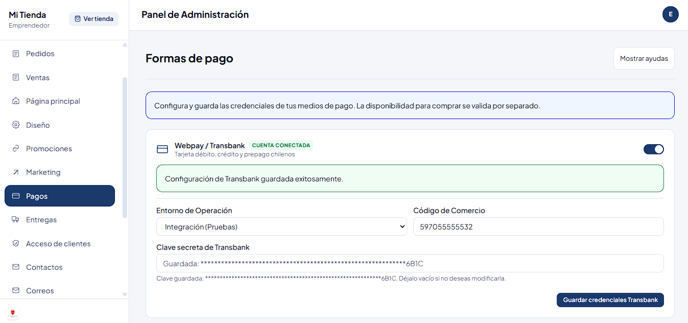

# Pruebas de integración de pagos

| Campo | Detalle |
| --- | --- |
| Ticket | SCRUM-499 · Realizar pruebas de integración de pagos |
| Evidencia | `docs/pruebas-integracion-pagos/` (capturas P0 a P10) |
| Resultado | 5 CUMPLE, 3 NO CUMPLE, 2 NO EJECUTABLE |

## 1. Alcance y método

Se valida la integración del sistema con los métodos de pago implementados: inicio de la transacción, respuesta exitosa, rechazo, indisponibilidad del proveedor, reintento y actualización del estado del pedido.

- **Webpay (Transbank):** ambiente de **Integración**, con las credenciales de prueba. Sin credenciales de producción ni cobros reales.
- **Transferencia bancaria:** aprobación y rechazo manual desde el panel de administración.
- **Linkify:** solo el inicio de la transacción (desde localhost no recibe el aviso de pago del proveedor).
- **Mercado Pago y PayPal:** el backend los marca como no disponibles para el checkout, por lo que no son ejecutables.

La indisponibilidad del proveedor (P4) se simuló cortando la conexión a internet del equipo antes de confirmar el pedido. Las pruebas se hicieron manualmente con el navegador (http://localhost:5173) y el panel de administración, con la aplicación levantada con Docker Compose.

## 2. Preparación (P0)

Se configuró Transbank en el panel de administración (Pagos → Transbank) con el ambiente **Integración** y se activó el método. La clave secreta no se muestra en la captura.

## 3. Casos ejecutados

| # | Pasarela | Escenario | Esperado | Resultado | Evidencia |
| --- | --- | --- | --- | --- | --- |
| P1 | Webpay | Pago aprobado | Pedido en estado Pagado | NO CUMPLE | P1.png, P1a.png|
| P2 | Webpay | Pago rechazado | Pedido no pagado y mensaje claro | NO CUMPLE | P2.png, P2a.png |
| P3 | Webpay | Pago abortado por el cliente | Pedido pendiente, sin pago registrado | NO CUMPLE | P3.png, P3a.png |
| P4 | Webpay | Proveedor no disponible (sin conexión con Webpay) | Mensaje claro, sin pago ni error 500 | CUMPLE | P4.png |
| P5 | Webpay | Reintento tras fallo del proveedor | Se puede reintentar sin duplicar el pedido | CUMPLE | P5.png, P5a.png |
| P6 | Transferencia | Aprobación manual | Estado Pagado | CUMPLE | P6.png, P6a.png |
| P7 | Transferencia | Rechazo manual | Pedido rechazado o cancelado | CUMPLE | P7.png, P7a.png |
| P8 | Transferencia | Aprobar dos veces el mismo pedido | Sin efectos duplicados | CUMPLE | P8.png |
| P9 | Linkify | Inicio de la transacción | Pedido pendiente creado y redirección a pago | NO EJECUTABLE | P9.png (ver sección 4) |
| P10 | Mercado Pago y PayPal | Activar y pagar | No ejecutable: bloqueado por el backend | NO EJECUTABLE | P10.png, P10a.png (ver sección 4) |

## 4. Escenarios no ejecutados

- **P9 · Linkify:** no se dispone de credenciales de prueba, por lo que se ejecutó con datos aleatorios. El sistema redirigió a `app.linkify.cl/pay/1234567/remote/25` (el número de cuenta configurado va en la dirección) y Linkify respondió "La página que buscas no existe" (`P9.png`). No se pudo validar la comunicación real con el proveedor ni la confirmación del pago (desde localhost no recibe el aviso).
- **P10 · Mercado Pago y PayPal:** se activaron ambos en el panel de Pagos y, en el checkout, el paso de pago mostró "La tienda no tiene medios de pago habilitados en este momento. Por favor, comunícate con el administrador." (`P10a.png`). El backend los marca como no disponibles para compras (pendiente de conciliación de moneda y de conectar el cobro al pedido), pero el panel permite activarlos sin ningún aviso.

## 5. Detalle de NO CUMPLE

### P1 · Webpay, pago aprobado

- **Qué ocurrió:** el pago se completó correctamente en el portal de Webpay (ambiente de Integración, tarjeta de prueba aprobada). Al volver a la tienda, el navegador mostró **HTTP 404** (`P1.png`) y el pedido `ORD-20261101-RVW2` quedó en estado **Pendiente** (`P1a.png`).
- **Qué se esperaba:** retorno a la tienda con la confirmación del pago y el pedido en estado Pagado.
- **Comprobación:** abierta la misma dirección en una pestaña nueva (método GET), la ruta existe y redirige al catálogo (`P1b.png`). El 404 solo ocurre en el retorno desde Webpay.
- **Causa probable :** la integración crea las transacciones con la API de Webpay , cuyo retorno al comercio es por POST. El frontend solo lee `token_ws` y `TBK_TOKEN` desde la URL , por lo que el retorno no se procesa y el pago nunca se confirma.
- **Impacto:** no se puede completar un cobro con Webpay; los casos que pasan por el mismo retorno (P2, P3 y P5) se ven afectados.

### P2 · Webpay, pago rechazado

- **Qué ocurrió:** en el portal de Webpay se eligió **Rechazar**. Al volver a la tienda, el navegador mostró **HTTP 404** (`P2.png`, pedido `ORD-20261101-UMAW`). El pedido no quedó pagado (estado Pendiente, `P2a.png`).
- **Qué se esperaba:** pedido no pagado y un mensaje claro de rechazo para el cliente.
- **Resultado:** el pedido no se cobra, pero el cliente no recibe ningún mensaje: ve una página de error.
- **Causa probable:** la misma del P1.

### P3 · Webpay, pago abortado

- **Qué ocurrió:** en el portal de Webpay se pulsó **Anular compra**. Al volver a la tienda, el navegador mostró **HTTP 404** (`P3.png`, pedido `ORD-20261101-WAVJ`). El pedido quedó Pendiente, sin pago (`P3a.png`).
- **Qué se esperaba:** pantalla de "Pago cancelado", aviso al backend del aborto y pedido pendiente sin pago.
- **Resultado:** el estado del pedido es correcto, pero no se muestra la pantalla de cancelación y el sistema no registra el aborto.
- **Causa probable:** la misma del P1.

## 6. Observaciones adicionales

- **P6 a P8, transferencia bancaria:** aprobar marca el pedido como Pagado (`P6.png`, `P6a.png`); rechazar lo cancela (`P7.png`, `P7a.png`); aprobar por segunda vez muestra "La transferencia ya estaba aprobada" sin duplicar efectos (`P8.png`).
- **Linkify en el panel:** su sección no tiene botón de guardar propio (solo guarda con "Guardar todos los métodos de pago") y para desactivarlo exige la clave privada.
- **Formulario de tarjeta del checkout:** el paso de pago de Webpay muestra un formulario con datos de demostración y campos de solo lectura (`CLIENTE DEMO`, `0000 0000 0000 0000`) aunque el pago real se hace en el portal de Webpay tras la redirección. Quizas seria mejor reemplazarlo por un aviso de redirección.

- **P4, sin pedido registrado:** cuando Webpay no responde, el checkout muestra un mensaje claro ("Webpay no responde en este momento. Intenta nuevamente más tarde") y no se crea ningún pedido, por lo que no hay registro que consultar en Seguimiento.
- **P5, reintento:** tras recuperar la conexión, el reintento funcionó, llegó al portal de Webpay y se creó un solo pedido (`ORD-20261101-EFM1`, Pendiente; `P5a.png`). Sin embargo, al anular la compra en ese reintento, el retorno a la tienda volvió a fallar con HTTP 404, igual que en P3.

## 7. Conclusión

Resultado: 5 CUMPLE (P4 a P8), 3 NO CUMPLE (P1 a P3) y 2 NO EJECUTABLE (P9, P10).

- **Webpay:** el inicio de la transacción, el pago en el portal, el manejo de indisponibilidad del proveedor y el reintento funcionan. El retorno desde Webpay falla con HTTP 404, por lo que no se puede confirmar un pago aprobado, rechazado ni abortado (P1 a P3).
- **Transferencia bancaria:** aprobación, rechazo y doble aprobación funcionan correctamente.
- **Linkify, Mercado Pago y PayPal:** no ejecutables con los datos disponibles ( sección 4).
