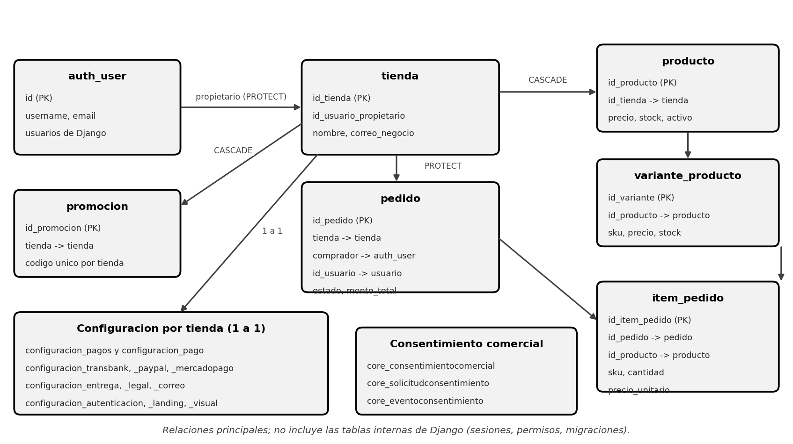

# SCRUM-484 — Configuración de PostgreSQL

Fecha: 2026-10-30. Fuente: archivos reales de la rama `develop` (commit `fba6a48`). Alcance: Base de datos relacional de OpenMind E-commerce.

| Campo | Detalle |
| --- | --- |
| Ticket | SCRUM-484 · Documentar configuración de PostgreSQL |
| Backlog | BL-410 |
| Componente | Base de datos relacional (servicio `db`) |
| Versión del código | Rama `develop`, commit `fba6a48` |
| Fecha | 30 de octubre de 2026 |
| Estado | Listo para validación |
| Relacionado | `EJECUCION_LOCAL.md` y los documentos SCRUM-482, SCRUM-485 y SCRUM-487 |

## 1. Propósito y alcance

Este documento describe cómo está configurado PostgreSQL: el servicio de Docker, las variables y la conexión con Django, el esquema de tablas, las restricciones, las migraciones, el acceso para consultar datos y los respaldos.

- **Incluye:** servicio, conexión, esquema, migraciones, consultas, respaldo y restauración, y seguridad.
- **No incluye:** MongoDB (SCRUM-485), las credenciales externas (SCRUM-487) ni la instalación de producción.

> **Una instalación, una tienda**
>
> Cada emprendedor recibe una instalación independiente, con una sola tienda y almacenamiento separado. El backend busca “la única tienda local” (`Tienda.objects.get()`) y informa error si hay ninguna o varias. Por eso la tabla `tienda` debe tener **exactamente una fila**.

## 2. Rol de PostgreSQL en el sistema

- Guarda los **datos transaccionales**: tienda, usuarios, pedidos, promociones, carrito y la configuración de cada módulo.
- Es la **fuente de verdad de la existencia de la tienda**; MongoDB no tiene una clave foránea automática hacia PostgreSQL, así que la aplicación valida esa relación.
- El catálogo detallado (variantes, atributos e imágenes) vive en **MongoDB**; en PostgreSQL existe además la tabla `producto` (sección 11).
- Solo el backend accede a la base de datos, mediante el ORM de Django y el driver `psycopg2-binary`.

## 3. Servicio de Docker

| Parámetro | Valor |
| --- | --- |
| Imagen | `postgres:15-alpine` |
| Nombre del contenedor | `postgres_consultoria` |
| Reinicio | `always` |
| Variables de arranque | `POSTGRES_DB`, `POSTGRES_USER` y `POSTGRES_PASSWORD`, tomadas del `.env` |
| Puerto | `${POSTGRES_PORT:-5432}:5432`: publicado en el computador (por omisión 5432) |
| Volumen | `postgres_data` montado en `/var/lib/postgresql/data` |
| Acceso del backend | Por la red de Compose, con host `db` y puerto `5432` |

> **Importante**
>
> `POSTGRES_USER` y `POSTGRES_PASSWORD` solo se aplican cuando el volumen está **vacío**, al crear la base por primera vez. Cambiarlos después en `.env` no modifica el usuario existente: la conexión del backend fallaría. Para cambiar la contraseña de una base ya creada se usa `ALTER USER` dentro de PostgreSQL.

## 4. Variables y conexión

| Variable en `.env` | Compose la entrega como | Opción de `DATABASES` en `settings.py` | Valor de ejemplo (`.env.example`) |
| --- | --- | --- | --- |
| `POSTGRES_DB` | `DB_NAME` | `NAME` | `ecommerce_db` |
| `POSTGRES_USER` | `DB_USER` | `USER` | `ecommerce_admin` |
| `POSTGRES_PASSWORD` | `DB_PASSWORD` | `PASSWORD` | `REEMPLAZAR_CON_PASSWORD_POSTGRES` (debe cambiarse) |
| (fijo en Compose) | `DB_HOST=db` | `HOST` | `db` |
| (fijo en Compose) | `DB_PORT=5432` | `PORT` | `5432` |
| `POSTGRES_PORT` (opcional) | No llega al backend | Solo el puerto publicado en el computador | `5432` |

El motor es `django.db.backends.postgresql`. Si faltan las variables, `settings.py` usa valores por defecto de desarrollo (`consultoria_db`, `postgres`, `postgrespassword`, `db` y `5432`): **no deben usarse fuera de un entorno local**.

> **Atención**
>
> El archivo `.env` y los respaldos de la base nunca se suben a Git. `.env.example` solo trae marcadores `REEMPLAZAR_...` que hay que sustituir por valores propios.

## 5. Esquema de la base de datos

### 5.1 Visión general



### 5.2 Tablas del negocio

| Tabla | Qué guarda | Claves y relaciones principales |
| --- | --- | --- |
| `tienda` | La tienda de la instalación | PK `id_tienda`; `id_usuario_propietario` → `auth_user` (PROTECT) |
| `usuario` | Usuarios del modelo propio (`correo` único, `rol`) | PK `id_usuario` |
| `producto` | Producto base: nombre, precio, stock y estado | `id_tienda` → `tienda` (CASCADE); precio y stock ≥ 0 |
| `variante_producto` | Variantes con SKU, precio, stock y atributos (JSON) | `id_producto` → `producto`; precio y stock ≥ 0 |
| `carrito` e `item_carrito` | Carrito del usuario y sus líneas | `id_usuario` único; una línea por variante y por producto base |
| `pedido` | Contacto, entrega, pago, montos y estado | `tienda`, `comprador` → `auth_user`, `id_usuario` → `usuario`; `clave_checkout` único |
| `item_pedido` | Líneas del pedido con copia de nombre, SKU, atributos y precio | `id_pedido`, `id_producto` y `producto_mongo_id` |
| `promocion` | Descuentos y cupones | `tienda`; código único por tienda |

Estados del pedido: `pendiente`, `pagado`, `preparando`, `en_origen`, `enviado`, `en_reparto`, `entregado` y `cancelado`.

### 5.3 Configuración por tienda (relación 1 a 1)

| Tabla | Qué guarda | Cifrado |
| --- | --- | --- |
| `configuracion_transbank` | Código de comercio, API key y ambiente | API key cifrada |
| `configuracion_paypal` | Client ID, client secret y ambiente | Client secret cifrado |
| `configuracion_mercadopago` | Public key, access token y ambiente | Access token cifrado |
| `configuracion_pago` | JSON `datos` de los medios de pago (incluye Linkify) | No |
| `configuracion_pagos` | JSON `metodos` con los campos de cada método de pago | No |
| `configuracion_entrega` | Retiro en tienda y despacho (JSON) | No |
| `configuracion_legal` | Contenidos legales y sus versiones (JSON) | No |
| `configuracion_correo` | Plantillas de correo (JSON) | No |
| `configuracion_autenticacion` | Métodos de ingreso de compradores y `google_client_id` | No |
| `configuracion_landing` y `configuracion_visual` | Página de inicio, diseño y logo del negocio | No |

### 5.4 Consentimiento comercial

- `core_consentimientocomercial`: estado de autorización por correo; único por tienda y correo.
- `core_solicitudconsentimiento`: solicitudes de confirmación, con el token guardado como hash y fecha de vencimiento.
- `core_eventoconsentimiento`: historial de **solo adición**; el modelo impide modificar o borrar sus filas desde la aplicación.

### 5.5 Tablas de Django

Además existen las tablas propias de Django: `auth_user`, `authtoken_token`, `authentication_userprofile` (teléfono y RUT único), `django_session`, `django_admin_log`, `django_migrations`, `django_content_type` y `auth_permission`, entre otras.

## 6. Restricciones de integridad

| Tipo | Restricciones |
| --- | --- |
| Valores no negativos | `chk_precio_valido` y `chk_stock_valido` (producto); `chk_variante_precio_valido` y `chk_variante_stock_valido`; `chk_monto_total_valido` (pedido); `chk_item_pedido_cantidad_valida` y `chk_item_pedido_precio_valido`; `chk_item_carrito_cantidad_valida` |
| Pedido | `chk_pedido_tiene_comprador` |
| Promoción | `chk_promocion_fechas_validas`, `chk_promocion_valor_no_negativo`, `chk_promocion_minimo_no_negativo`, `chk_promocion_codigo_cupon`, `chk_promocion_tipo_valido` y `chk_promocion_descuento_valido` |
| Consentimiento | `chk_consentimiento_evidencia` y `chk_consentimiento_normalizado` |
| Únicas | `usuario.correo`, `pedido.clave_checkout`, `uq_promocion_codigo_por_tienda`, `uq_item_carrito_variante`, `uq_item_carrito_producto_base` y `uq_consentimiento_tienda_email` |

## 7. Migraciones

| Aplicación | Migraciones | Última |
| --- | --- | --- |
| `core` | 33 | `0029_tienda_correo_negocio` |
| `authentication` | 3 | `0003_configuracion_pagos` |
| `landing` | 3 | `0003_configuracionlanding_contenido` |
| `visual_config` | 2 | `0002_configuracionvisual_logo_negocio` |
| `catalog` y `shipping` | 0 | Sin tablas propias en PostgreSQL |

> **Importante**
>
> El backend **no aplica las migraciones al iniciar**: el comando del servicio solo ejecuta `sync_mongo_indexes` y `runserver`. Después de levantar por primera vez y después de cada actualización hay que ejecutar `migrate` a mano.

```powershell
docker compose exec backend python manage.py migrate
docker compose exec backend python manage.py showmigrations
docker compose exec backend python manage.py check
```

- `core` tiene números repetidos (0006, 0016, 0021 y 0024) unidos con migraciones de fusión (`merge`): es normal y no deben borrarse.
- `0023_reconciliar_promocion_historica` exige PostgreSQL: falla en SQLite (comprobado al correr las pruebas con SQLite).
- No ejecutar migraciones inversas sin evaluar el impacto en los datos (`EJECUCION_LOCAL.md`, sección 4.4).

## 8. Acceso y consultas

```powershell
# Abrir la consola de PostgreSQL dentro del contenedor
docker compose exec db sh -c 'psql -U "$POSTGRES_USER" -d "$POSTGRES_DB"'
```

| Para qué | Comando o consulta |
| --- | --- |
| Listar las tablas | `\dt` |
| Ver la estructura de una tabla | `\d tienda` |
| Comprobar la tienda de la instalación | `SELECT id_tienda, nombre, correo_negocio FROM tienda;` |
| Contar los pedidos por estado | `SELECT estado, COUNT(*) FROM pedido GROUP BY estado ORDER BY 2 DESC;` |
| Ver las últimas migraciones aplicadas | `SELECT app, name FROM django_migrations ORDER BY id DESC LIMIT 5;` |
| Salir | `\q` |

Con una herramienta gráfica (DBeaver o pgAdmin) la conexión usa host `localhost`, el puerto publicado y la base, el usuario y la contraseña del `.env`. Es válido **solo en desarrollo**.

## 9. Respaldo y restauración

Los comandos de respaldo son los de `EJECUCION_LOCAL.md` (sección 4.1). Se ejecutan en PowerShell desde la raíz del proyecto.

```powershell
# Respaldo
docker compose exec db sh -c 'pg_dump -U "$POSTGRES_USER" -d "$POSTGRES_DB" -Fc -f /tmp/openmind-postgres.dump'
docker compose cp db:/tmp/openmind-postgres.dump ./backups/openmind-postgres.dump

# Restauración (en un entorno de prueba o ante una emergencia)
docker compose cp ./backups/openmind-postgres.dump db:/tmp/openmind-postgres.dump
docker compose exec db sh -c 'pg_restore -U "$POSTGRES_USER" -d "$POSTGRES_DB" --clean --if-exists /tmp/openmind-postgres.dump'
```

- Verificar que el archivo exista y tenga contenido. La carpeta `backups/` está ignorada por Git.
- Los comandos de restauración son el procedimiento estándar de PostgreSQL y deben probarse en un entorno de prueba antes de usarlos con datos reales.

> **Atención**
>
> Un respaldo contiene datos personales y las credenciales de pago cifradas con `PAYMENT_CREDENTIALS_KEY`. Guardarlo en un lugar protegido y no compartirlo. Sin esa clave, las credenciales del respaldo no se pueden descifrar.

## 10. Seguridad y paso a producción

- **No publicar el puerto 5432 en producción:** quitar el bloque `ports` del servicio `db` para que solo el backend lo alcance.
- Usar contraseñas propias y largas; no reutilizar las de ejemplo ni las de `settings.py`.
- Las contraseñas de usuarios nuevas se guardan con **Argon2**, y se siguen verificando los hashes históricos PBKDF2 (`PASSWORD_HASHERS`).
- Tres columnas guardan secretos **cifrados** con Fernet y el prefijo `enc::` (ver SCRUM-487).
- No compartir la salida de `docker compose config`: puede mostrar las contraseñas ya sustituidas.

## 11. Relación con MongoDB

- El producto existe en **ambas bases**: la tabla `producto` (y `variante_producto`) en PostgreSQL y el documento de `productos` en MongoDB, vinculados por `id_producto`.
- Crear un producto desde el panel genera el registro en PostgreSQL y el documento equivalente en MongoDB.
- Eliminar un producto es una **baja lógica**: se marca `activo = false` en las dos bases.
- `item_pedido.producto_mongo_id` apunta al documento de MongoDB. El campo `tienda_id` de MongoDB es el `id_tienda` escrito como texto.

## 12. Observaciones técnicas para el equipo

No bloquean este ticket, pero conviene tenerlas presentes.

- **Dos tablas de usuarios:** `usuario` (modelo propio) y `auth_user` (Django). La tabla `pedido` referencia a ambas (`id_usuario` y `comprador`).
- **Dos tablas de pagos con nombre casi igual:** `configuracion_pago` (core) y `configuracion_pagos` (authentication).
- **Secretos en JSON sin cifrar:** las claves de Linkify y los datos de transferencia viven en columnas JSON (ver SCRUM-487).

## 13. Verificación y problemas frecuentes

|  | Comprobación | Resultado esperado |
| --- | --- | --- |
| [ ] | `docker compose ps` | El servicio `db` está en ejecución |
| [ ] | `docker compose exec backend python manage.py check` | Sin errores |
| [ ] | `docker compose exec backend python manage.py showmigrations` | Todas las migraciones con `[X]` |
| [ ] | `SELECT COUNT(*) FROM tienda;` | Devuelve 1 |
| [ ] | Respaldo con `pg_dump` | Archivo creado y con tamaño mayor que cero |

| Síntoma | Causa probable | Qué hacer |
| --- | --- | --- |
| Tablas no encontradas | Faltan las migraciones | `docker compose exec backend python manage.py migrate` |
| `password authentication failed` | Se cambió la contraseña en `.env` después de crear el volumen | Volver al valor original o usar `ALTER USER` |
| No resuelve el nombre `db` | El backend se ejecuta fuera de Compose | Ejecutarlo con Compose o apuntar `DB_HOST` a `localhost` |
| Puerto 5432 ocupado | Hay otro PostgreSQL en el computador | Cambiar `POSTGRES_PORT` en `.env` |
| Se perdieron los datos | Se ejecutó `docker compose down -v` | Restaurar desde un respaldo; no usar `-v` si se quieren conservar |

## 14. Referencias

- `EJECUCION_LOCAL.md`: migraciones (3.2), respaldos (4.1) y problemas frecuentes (5).
- `docs/scrum-43-propiedad-emprendedor-tienda.md` y `docs/scrum-44-identificacion-interna-tienda.md`: una instalación por emprendedor.
- `backend/config/settings.py`, `backend/apps/*/models.py` y `docker-compose.yml`.
